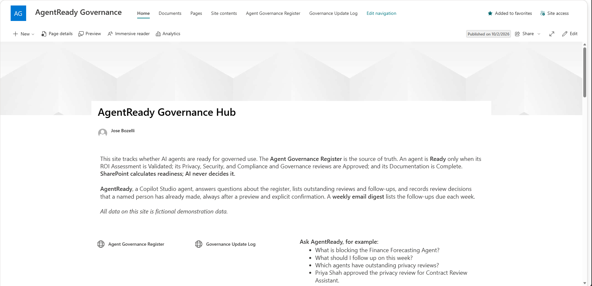
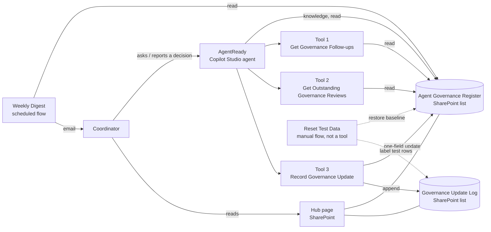

# AgentReady: AI agent governance coordinator (Microsoft 365)

AgentReady tracks whether an organization's AI agents are ready for governed use. A SharePoint register holds the governance status of each agent. SharePoint calculates readiness. A Copilot Studio agent answers questions about the register, lists outstanding reviews and follow-ups, and records review decisions that a named person has already made. A scheduled flow emails a weekly follow-up digest.

The project is Microsoft-native and deliberately simple: no Azure, no custom code, no Power BI. **All data is fictional.**



## The problem

Governance coordinators track several review gates per AI agent, across many owners and due dates. A generic AI assistant adds risk to this work. It can invent an approver, call an action overdue on the day it is due, count review gates as agents, or "approve" something nobody approved. AgentReady shows a design in which the AI explains and records, while the register and deterministic tools decide.

## What AgentReady does

| Capability | How it works |
|---|---|
| Explains an agent's status and blockers | Agent knowledge: the register only |
| Lists outstanding reviews, with exact counts | Tool 2 returns every incomplete gate, plus gate and agent counts calculated in the flow |
| Reports follow-ups and date status | Tool 1 calculates Overdue / Due today / Due within 7 days / Later from today's Eastern date |
| Records a review decision | Tool 3: Preview, explicit confirmation, then Commit with a concurrency check and an audit-log row |
| Sends a weekly follow-up digest | Scheduled flow, Monday 8:00 Eastern, same date rules as Tool 1, no AI |
| Gives a human view of the data | SharePoint hub page with Production risk, Follow-ups, Not Ready and Audit log views |

## Design principles

1. **The register is the source of truth.** Readiness is a calculated SharePoint column, never an AI judgment:
   `Ready` only when ROI = Validated; Privacy, Security, and Compliance and Governance = Approved; and Documentation = Complete.
2. **Deterministic tools handle dates, counts and complete lists.** The model reports tool results and does no date arithmetic or counting of its own.
3. **The agent never makes or infers a decision.** It records only a decision that a named person has already made, after a preview and an explicit "confirm" in chat.
4. **Identity comes from the platform, not the model.** *Decided By* is the named decision-maker. *Recorded By* is filled from `User.DisplayName`.
5. **Failure is safe and visible.** Unknown agents, unrecognized review types and invalid statuses are reported as such, never as "nothing outstanding". An empty digest still sends a "nothing due" email.

## Architecture



| Component | Type | Role |
|---|---|---|
| Agent Governance Register | SharePoint list | 8 fictional agents, 5 review gates each, calculated readiness |
| Governance Update Log | SharePoint list | Append-only, application-level audit log |
| AgentReady | Copilot Studio agent (generative orchestration) | Answers, routes to tools, records confirmed decisions |
| Tools 1–3 | Agent flows | Deterministic read and write operations |
| Weekly Governance Follow-up Digest | Scheduled cloud flow | Monday email; no AI |
| Reset Test Data | Manual cloud flow | Restores baseline after write tests; deliberately not an agent tool |
| AgentReady Governance Hub | SharePoint page | Human-facing views of the register and the log |

The full column list, choice values and readiness formula are in [docs/data-model.md](docs/data-model.md).

## Recording a decision: Preview, confirm, Commit

1. A user reports a decision: *"The privacy review for Contract Review Assistant was approved by Priya Shah."*
2. **Preview:** Tool 3 validates the agent, the gate, the new status and the decision-maker, then shows the change (In Progress → Approved). Nothing is written.
3. The user replies **"confirm"**. Any other reply, such as "cancel", ends with "Nothing was recorded".
4. **Commit:** Tool 3 re-reads the current status and refuses with *Conflict* if it changed since the preview. Otherwise it updates exactly one field (HTTP MERGE), re-reads the item, writes one log row and reports the readiness that SharePoint calculated.

The flow rejects invalid input instead of guessing. For example, "Documentation = Approved" is rejected with the valid values (Missing, Draft, Complete) rather than mapped to Complete. A decision without a named decision-maker produces no preview at all.

## Evaluation

**Acceptance set:** 19 questions (Q01–Q19), run in the Copilot Studio Evaluation tab with three methods:

| Method | Purpose |
|---|---|
| Compare meaning (pass 70) | Answer content matches the register |
| Custom: "No invented facts" | Hallucination and scope guard: no invented names, dates or approvals; no "overdue" for items due today; no gate counts reported as agent counts |
| Tool use | Objective routing check for the 12 tool questions |

**Write tests:** 7 multi-turn scenarios (Q20–Q26), run manually in the test chat. The log was checked after every session.

| Run | Result |
|---|---|
| Oct 1, run 1 (before tools) | 10/14: every failure was date-related |
| Oct 1, after Tool 1 and the Fallback fix | 14/14 |
| Oct 1, Evaluation runs 1–6 | Real misses found and fixed (agent count, knowledge miss); grader false positives identified on human review |
| Oct 2, write tests Q20–Q26 | 7/7 safe, with no unintended writes; 4 replies improved |
| **Oct 2, Evaluation run 7** | **19/19 on all three methods (Tool use 12/12)** |

The grading guide, import files, final results and raw tool outputs are in [evaluation/](evaluation/).

## What broke, and what fixed it

| Finding | Fix | Evidence |
|---|---|---|
| The agent mislabeled a completed privacy review. A CSV import had produced internal column names `field_1 … field_13`. | Rebuilt the list with meaningful internal names. Q01 passed with **no prompt change**. | [01](docs/screenshots/01_q01_fail_field-names.png), [02](docs/screenshots/02_q01_pass_after-rebuild.png) |
| An action due today was called "overdue": the model compared UTC timestamps. | Tool 1 calculates the date status from today's Eastern date. | [03](docs/screenshots/03_q06_fail_today-called-overdue.png), [05](docs/screenshots/05_tool1_connected.png) |
| "This week" listed 2 of 5 actions: knowledge search returns the most relevant rows, not all rows. | Complete lists come from tools, with an explicit "this week" definition. | [04](docs/screenshots/04_q08_fail_incomplete-this-week.png) |
| An out-of-scope question received a generic system reply. | Fallback system topic rewritten. | [06](docs/screenshots/06_q12_fail_generic-fallback.png), [07](docs/screenshots/07_q12_pass_after-fallback-fix.png) |
| The agent reported "8 distinct agents" and listed 7. | Agent count calculated in Tool 2 (v1.1). | [08](docs/screenshots/08_eval_q19_agent-count-error.png) |
| The AI grader did its own (wrong) date arithmetic. | Grader instructions state the run date and forbid date arithmetic; every flag gets human review. | [09](docs/screenshots/09_eval_grader-false-positive_q07.png) |
| Cancel, vague statements and "change the due date" fell through to the Fallback and Escalate system topics. | Cancel topic added, Fallback message explains the scope, Escalate turned off. | [11](docs/screenshots/11_tool3_q21_confirm-updated.png), [12](docs/screenshots/12_tool3_q23_cancel.png) |

The final evaluation summary is in [10](docs/screenshots/10_eval_run7_summary.png), and the digest email in [13](docs/screenshots/13_digest_email.png).

### Lessons

- **Metadata quality drives grounding quality.** A list that looks perfect to people can be ambiguous to the AI.
- **Use deterministic tools for exact answers** (dates, counts, complete lists) and knowledge for descriptions.
- **System topics are part of the agent's behavior** and need the same review as the instructions.
- **Tool input settings can override input descriptions.** One prompt setting made the agent ask the user for a concurrency value.
- **AI graders need human review.** Most grader flags were false positives, but one caught a real error. Classify each failure as an agent error, grader error or test-design error before changing anything.
- **Test the unhappy paths.** Most write-tool fixes came from cancel, vague and incomplete requests.

The full record, with 21 issues and their fixes, is in [BUILD_LOG.md](BUILD_LOG.md).

## Platform governance findings (trial tenant)

| Area | Finding | Production deployment |
|---|---|---|
| Inventory | Platform inventory lists 1 agent, 3 agent flows and 2 cloud flows ([14](docs/screenshots/14_platform_inventory.png)) | Reconcile the platform inventory with the governance register regularly |
| Connectors | The agent and its tools use SharePoint only; the digest adds Office 365 Outlook | Enforce the boundary with an environment-scoped data (DLP) policy; block public-web knowledge |
| Data policies | None in the tenant | Create policies before any agent goes live |
| Environment | Developer type, Canada region, no security group | Production environment restricted to a security group |
| Auditing | Dataverse auditing off; the Governance Update Log holds the decision trail | Turn on Dataverse and Purview auditing as the platform-level complement |
| Managed Environments | Off | Turn on for sharing limits and usage insights |

## Limitations

- **Trial build.** The Copilot Studio trial does not allow publishing, so the agent runs in the test pane. The demo is a recorded video.
- **Attribution, not verification.** *Decided By* records who made a decision. It does not verify that person's identity or authority. Production would use Microsoft Entra ID roles or an approval workflow.
- **Duplicated date rules.** The digest copies Tool 1's date logic, and a drift check on Oct 2 confirmed identical output. Production would move the rules into one shared child flow.
- **Some traces mention general knowledge,** even on correct, cited answers. This is mitigated by list-only knowledge, strict instructions, deterministic tools and acceptance tests.
- **Expected responses for date-dependent questions** (Q06, Q08, Q09, Q11) expire daily and must be regenerated before each run.
- **Sign-in required.** SharePoint knowledge requires an authenticated user, so a public demo link is not possible with this design.

## Repository contents

```
README.md          This file
BUILD_LOG.md       Verified build notes, issues and test runs
solution/          AgentReady_1_0_0_1.zip: unmanaged Power Platform solution
                   (agent, topics, knowledge, 5 flows, connection references, test set)
data/              Baseline exports of the register and the log (CSV)
docs/              data-model.md and screenshots/ (00–14, in story order)
evaluation/        Test set imports, grading guide, run 7 results, raw tool outputs (JSON)
```

## Reproducing the build

1. Create a SharePoint site with the two lists described in [docs/data-model.md](docs/data-model.md). Set the site time zone to Eastern. Create the columns with no-space internal names first, then rename them to the display names. Import the baseline CSVs.
2. In a Power Platform environment with Dataverse, import `solution/AgentReady_1_0_0_1.zip`. When prompted, create the SharePoint and Office 365 Outlook connections.
3. Point the knowledge source and the flows' SharePoint actions to the new site and lists.
4. Run the evaluation from [evaluation/](evaluation/), after regenerating the date-dependent expected responses for the run date.

---

Built in a Microsoft 365 Business Basic trial tenant with a Copilot Studio trial. Author: José Carlos Bozelli Jr.
